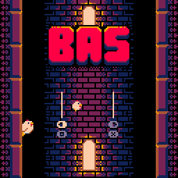

<div align="center">



<h3>BAS for the CHGame handheld, rewritten in native C++</h3>

<p>yokoboko's PICO-8 tower-climber, frame for frame.<br>
No Lua interpreter: the cart's Lua ported by hand and checked against the original, frame by frame.</p>

<a href="Bas/README.md">How to play</a> · <a href="BUILDING.md">Building it</a> · <a href="Bas/NOTES.md">How it was made</a> · <a href="docs/pico8-to-chgame.md">From PICO-8 to CHGame</a>

</div>

## About the game

Climb the tower: jump from wall to wall, past the saws, ahead of the saw
trap rising from below. Each jump is a point, the trap speeds up as you
score, and your best is kept.

[BAS](https://www.lexaloffle.com/bbs/?tid=54986) (B.A.S., *Birds and Saws*) is
yokoboko's PICO-8 demake of their own mobile game. The CHGame has the same
128x128, 16-colour screen as PICO-8, so the sprites and sound come straight
out of the cart, and the Lua was rewritten in C++ for the CHGame's RISC-V chip.

### Controls

| Button | Action |
|---|---|
| LEFT or A | Jump to the left wall |
| RIGHT or B | Jump to the right wall |
| START | Pause: continue, exit to menu |
| START, held 3 s | Back to the CHGame menu |

### Features

- **The original game, frame for frame,** at the cart's 60 frames a second,
  down to PICO-8's 16.16 number rounding and wrapping.
- **The original art, music and sound effects,** extracted from the cart.
- **Your best score is saved** in the CHGame's flash.
- **A pause menu,** which the cart's PICO-8 pause button had.

## Getting started

Build it and upload it to the handheld, or make a cart for the SD menu:
see [BUILDING.md](BUILDING.md).

## How it works

```
assets/bas.p8  ──► tools/p8extract.py ──► Bas/src/assets/   sprites, map, palette
               └─► tools/p8audio.py   ──► Bas/src/audio/    effects, songs
cart's __lua__ ──► (by hand)          ──► Bas/Game.cpp      the game, class by class
```

- **[Game.cpp](Bas/Game.cpp)** is the cart's Lua, in its order and with its
  names. It knows nothing of CHGame: it draws through [P8.cpp](Bas/P8.cpp),
  which reimplements PICO-8's drawing calls.
- **[Fix.h](Bas/Fix.h)** gives the game PICO-8's 16.16 fixed-point numbers.
  No floating point reaches the chip.
- About 33 KB of the 50,432 B of flash and 15 KB of the 18,416 B of RAM.

## How it was checked

[tools/ref/compare.py](tools/ref/compare.py) runs the cart's own Lua on the
PC next to `Game.cpp`, on the same button presses, and compares the scene,
the player, the saws, the trap, the score and the saved best after every
frame. 18 of 18 runs agree, up to 12,000 frames each, including bots that
score over 900. Details are in [Bas/NOTES.md](Bas/NOTES.md).

## License

- **The game** (BAS by yokoboko: its code as translated here, art, map,
  music and sound) is licensed under
  [CC BY-NC-SA 4.0](https://creativecommons.org/licenses/by-nc-sa/4.0/), as
  the original cart is: non-commercial use only, with credit to yokoboko,
  and changes shared under the same licence. See [Bas/NOTICE](Bas/NOTICE).
- **The port's framework and tools** come from
  [Cheleste](https://github.com/bateske/CHeleste) and are MIT
  ([LICENSE](LICENSE)).
- **The CHGame libraries** in `chgame/` keep their own licences
  ([chgame/LICENSE](chgame/LICENSE), [chgame/NOTICE](chgame/NOTICE)).

The original cart is not in the repository; the data generated from it is.

## Acknowledgments

- **yokoboko**, for [BAS](https://www.lexaloffle.com/bbs/?tid=54986)
  ([source](https://github.com/yokoboko/bas-pico-8)).
- **bateske**, for [Cheleste](https://github.com/bateske/CHeleste), whose
  framework, tools and porting guide this port is built on, and for
  [CHGame](https://github.com/bateske/CHGame).
- **[Lexaloffle](https://www.lexaloffle.com/pico-8.php)**, for PICO-8.

Ported by Jadflat with the help of Claude (Anthropic).
